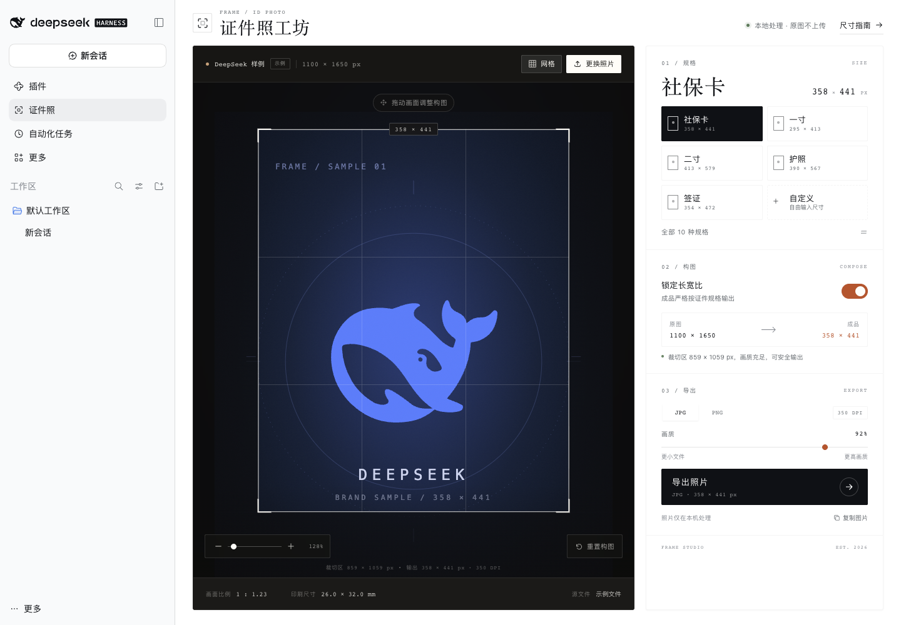
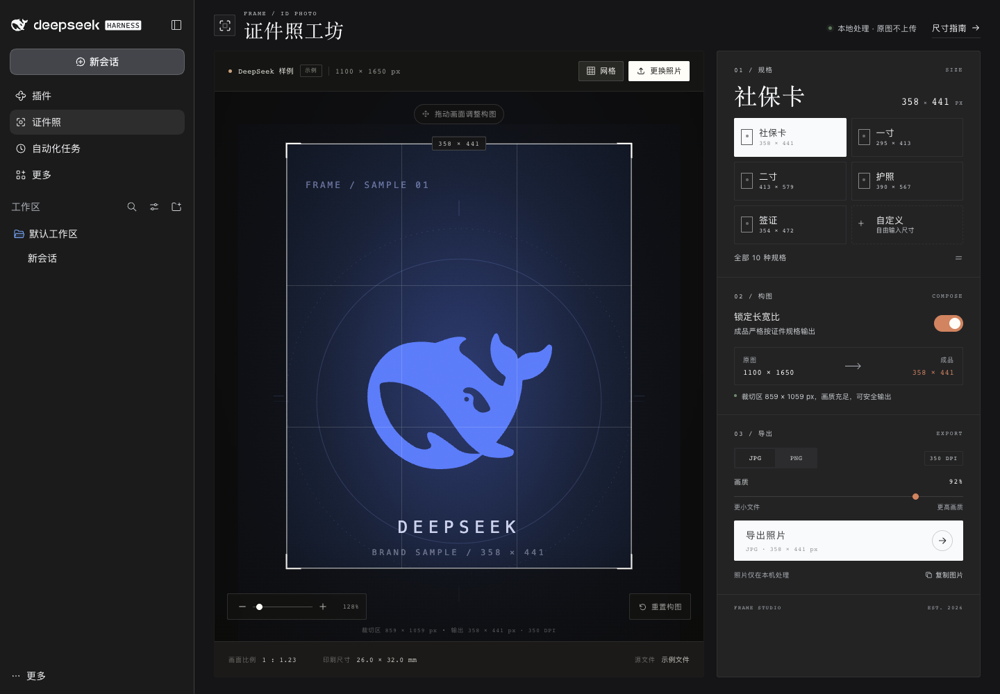

# FRAME · 证件照工坊

DeepSeek Harness 左侧工具栏插件。为社保卡、护照、签证等证件照精确裁切尺寸，默认内置 **社保卡 358 × 441 px**，照片全程在浏览器本地处理。



## 使用

插件已安装到当前 `desktop` profile，入口在左侧工具栏的 **证件照**：

1. 如果当前页面还没出现，刷新 Harness 页面。
2. 左侧工具栏点击 **证件照**。
3. 上传照片，选择规格，调整构图，导出 JPG / PNG。

如果刷新后仍没有入口，运行 `./install-dsh-plugin.sh`，再刷新页面或重启 Harness。



## 核心逻辑

| 模式 | 行为 | 成品尺寸 |
| --- | --- | --- |
| 锁定长宽比（默认） | 裁切框锁定证件规格比例，等比缩放后裁切，画面不拉伸 | 严格等于预设，如 358 × 441 |
| 不锁定长宽比 | 裁切框可自由缩放；先按「长边 / 宽 / 高」定尺，另一侧裁切 | 按当前裁切比例等比推导 |

不锁定模式下，如果裁切比例接近标准比例，会自动吸附到标准尺寸；点击「恢复 358 × 441」会重新锁定标准比例。

## 功能

- 10 种常见规格：社保卡、一寸、小一寸、大一寸、二寸、小二寸、护照、签证、驾驶证、学籍照。
- 自定义像素尺寸（16–6000 px）。
- 拖拽、滚轮 / 双指缩放、自由构图、三分网格。
- JPG（60–100 画质）/ PNG 导出。
- JPG 写入对应 DPI（社保卡 350 DPI，其余常见规格 300 DPI），并显示毫米印刷尺寸。
- 低分辨率放大提醒。
- 复制 PNG 到剪贴板。
- 自动跟随 Harness 的浅色 / 深色主题。
- 响应式：宽屏双栏，窄屏上下堆叠。

## 目录

```text
dsh-plugin/               DSH 插件包（client + bundle patch + locale + icon）
  src/                    UI 源码：studio.html / studio.css / studio.js
  client.js               由构建脚本生成的浏览器端 bundle
build-dsh-plugin.mjs      构建生成 client.js
screenshots/              插件截图
index.html                独立网页版（可选）
```

## 重新构建

```bash
node build-dsh-plugin.mjs
```

然后重新部署到当前 profile：

```bash
./install-dsh-plugin.sh
```

脚本会复制插件、写入 `package.json` 的依赖与 `dsh.profile.bundles`。DSH 的 profile HMR 会重新加载插件；若未出现，刷新页面或重启 Harness。

## 独立网页版（可选）

同一套裁切引擎也保留为独立网页版：

```bash
./start.sh
# 打开 http://127.0.0.1:8123/
```

## 发布到 GitHub

本目录已初始化为 Git 仓库并完成首次提交。创建远端仓库并 push：

```bash
gh auth login
gh repo create dsh-frame-id-photo --public --source=. --remote=origin --push
```

完整步骤（Token 方式、Release、GitHub Pages 在线预览）见 [PUBLISH.md](PUBLISH.md)。

## 隐私

图片通过浏览器本地文件 API 读取，使用 Canvas 完成裁切和导出，不发起上传请求。示例图以 data URI 内置，插件运行时不依赖网络。

## 说明

- 像素尺寸是投稿系统最常用的校验依据；毫米尺寸按 DPI 换算，供打印参考。
- 各受理机构对背景颜色、头部占比、文件大小可能有额外要求，请以最新官方要求为准。
- 示例图使用 DeepSeek 鲸鱼图标作为占位样例；DeepSeek 名称与图标是 DeepSeek 的商标，仅作演示，不包含在 MIT 授权范围内。

## License

代码、界面与插件图标以 MIT License 发布；DeepSeek 名称与鲸鱼图标归 DeepSeek 所有，仅作为演示样例使用。
